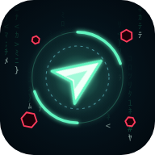

# Last Signal

A survival game in the code rain. You are the last process the system couldn't erase:
outrun the swarm, build impossible weapons, and take down the Root Process.

**Play:** https://narx00.github.io/last-signal/ (also runs as a Telegram Mini App)

## Features

- Auto-firing weapons, systems and evolutions, five bosses and the Root Process.
- **Rewrite**: program your weapons with code lines such as `on_kill → if(crowded) → burst()`,
  built from trigger, condition and effect pieces in an in-game editor.
- Operators, powers, a Kernel of permanent upgrades, a Code library, specializations,
  mutations, routes and a Nemesis rival.
- A shared leaderboard and daily challenge board, and in-game feedback (Settings, pause or end of run).
- Keyboard, mouse or touch. In Telegram, progress is saved to your Telegram account, and an
  unfinished run can be resumed after closing the app.
- English, Russian and Hebrew (right to left). The game follows the Telegram or browser language;
  Settings → Language switches it.

## Controls

- Move: WASD or arrow keys, hold the mouse, or drag anywhere on a phone.
- Upgrade: click a card or press 1–3.
- Powers: Q / Space and E, or the round buttons on a phone.
- Pause: Esc or P.

## Working on the game

The game is JavaScript and ships as a single `index.html`. Python tools build and check it.

    python tools/check.py     check data/ and assets/ for mistakes
    python tools/build.py     build index.html (and dist/ for publishing)
    python tools/sim.py       run the balance bot (needs Playwright)
    python tools/i18n.py      list new or untranslated texts for a language

- `src/` game code, styles and markup, split by topic
- `data/` editable tables: enemies, weapons, systems, bosses, texts
- `assets/` optional sprites, icons and music
- `i18n/ru/`, `i18n/he/` the Russian and Hebrew translations
- `docs/CONTENT.md` how to add enemies, art, icons, music and translations
- `docs/MONITORING.md` live player count, stats (`monitor.html`) and the leaderboard
- `assets/brand/` the game icon (`icon.svg`; `python tools/render_icon.py` renders the PNGs)

Pushing to `main` checks, builds and publishes the site through GitHub Actions.
